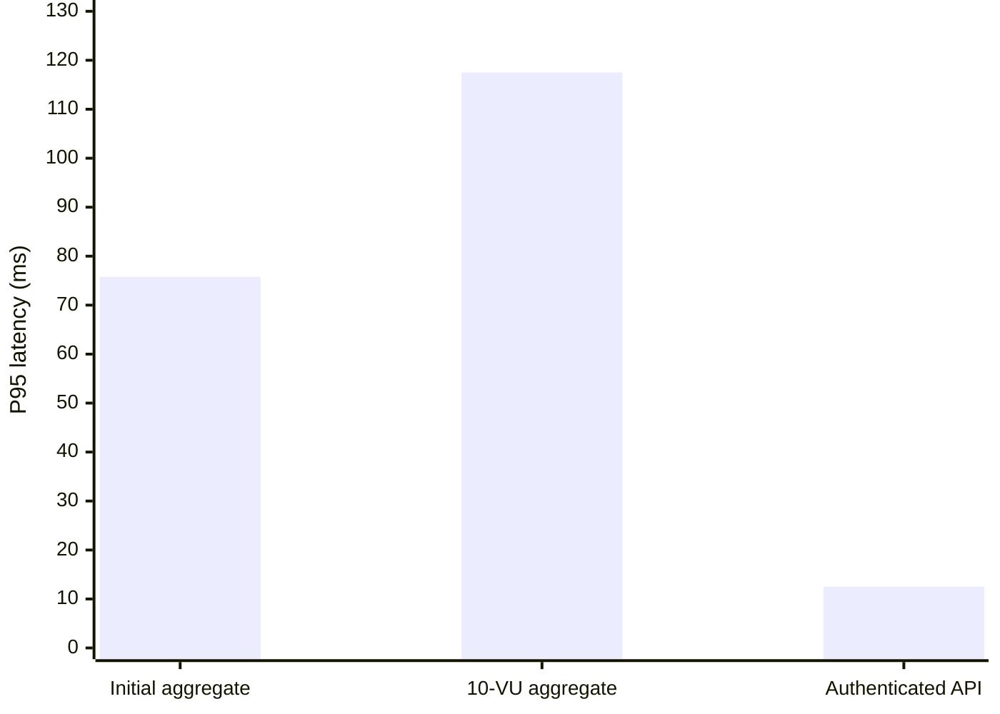
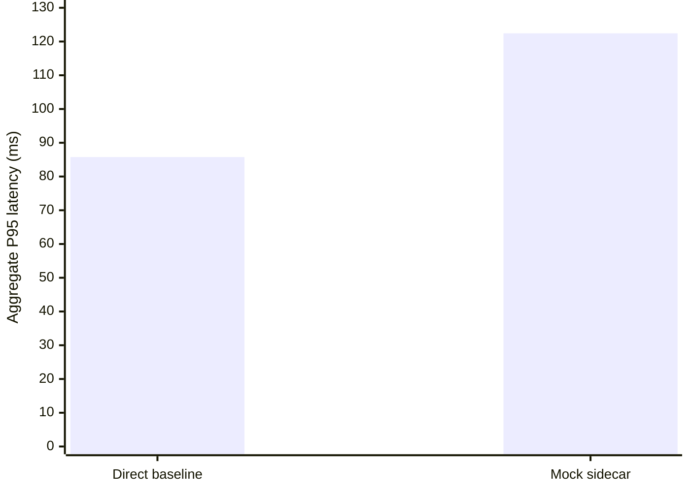

# API-Sentinel Performance and Security Validation Report

> Compiled from existing project evidence. This report does not represent
> a new security test, production certification, or independent audit.

## Executive summary

The available evidence demonstrates functional security controls and
controlled enforcement experiments in a local synthetic API environment.
The evidence does not establish production readiness or complete security
certification.

- Day 5 authenticated API performance acceptance: PASS at 12.50 ms P95.
- Day 5 original 10-VU aggregate baseline: P95 threshold FAILED at 117.511 ms.
- Day 15 monitoring overhead: strict less-than-5-ms target FAILED.
- Day 23 controlled loopback kernel-drop certification: PASS.
- Phase 3 overall freeze: CONDITIONAL.
- Day 26 OWASP regression coverage: PARTIAL at 57.14%.
- Day 27 endurance status: see detailed evidence below.

## Methodology

- Compile existing JSON reports, Markdown documentation, and test files.
- Preserve the scope and evidence type stated by each source.
- Prefer recorded source values over inferred or reconstructed metrics.
- Treat test definitions as evidence of coverage, not proof of historical execution.
- Do not convert missing, malformed, skipped, or partial evidence into a pass.
- Distinguish application-layer simulations from kernel packet-drop evidence.
- Treat local synthetic results as lab observations, not production guarantees.

## 1. Evidence handling

- Metrics are read from existing reports or explicitly identified documentation.
- Missing, malformed, or incomplete evidence is not treated as a pass.
- Application-layer simulations are distinguished from kernel-drop evidence.
- Controlled local-lab results are not presented as production guarantees.

## 2. Verified milestone evidence

### Day 5 — Baseline performance benchmark

- Source is the benchmark documentation; the referenced raw result files were not present in the inspected benchmark-results directory.
- Initial 30-second baseline: 3,918 requests, 130.485 requests/s, average latency 14.814 ms, P95 75.761 ms, 0% HTTP failures, and 100% checks passed.
- Official 10-VU, 30-second run: 2,838 requests, 93.050 requests/s, average latency 22.595 ms, P95 117.511 ms, and P99 219.393 ms.
- The official aggregate P95 failed the required less-than-50-ms threshold. HTTP failures were 0% and checks passed 100%.
- Login was the observed latency hotspot: average 115.889 ms and P95 231.775 ms.
- Revised authenticated-only acceptance run: P95 12.50 ms, P99 20.39 ms, 0% HTTP failures, 0% custom errors, and 100% checks.
- Bootstrap login P95 was 561.34 ms and was reported separately; it was excluded from the authenticated API P95 gate by design.
- The authenticated-only result passed its stated performance threshold, but does not independently establish Phase 1 freeze approval.
- The documentation reports an inconsistency between the original JSON threshold metadata and console/raw metric values. The documented console outcome is retained; JSON threshold flags are not treated as authoritative.
- These are local synthetic measurements, not production capacity estimates.
- Source: `docs/benchmark-baseline.md`.

### Days 2, 8, 9 and 10 — Authentication, BOLA and API exposure coverage

- **Day 2:** Authentication and authorization regression tests, including token validation, own-resource access, cross-user order controls, and intentional billing BOLA and legacy-route cases.
  - Test source: `tests/test_day2_auth_bola.py`.
- **Day 8:** BOLA attack-harness classification, targeted invoice checks, cross-user findings, own-invoice controls, and local-target validation.
  - Test source: `tests/test_day8_bola_attack.py`.
- **Day 9:** Privilege-escalation harness classification, collection checks, an eight-case test matrix, and intentional billing escalation behavior.
  - Test source: `tests/test_day9_privesc_attack.py`.
- **Day 10:** Shadow and zombie endpoint behavior, unauthenticated or weakly authenticated legacy routes, and controls protecting v2 endpoints.
  - Test source: `tests/test_day10_shadow_zombie.py`.
- These files establish the presence of regression tests and attack-harness logic. They do not establish that a historical attack campaign was executed or provide an archived runtime finding count.
- The intentionally vulnerable billing and legacy endpoints are lab fixtures; they must not be interpreted as acceptable production behavior.

### Day 12 — Shadow and zombie API ground truth

- The available manifest documents seven representative endpoints. It is explicitly reconstructed from tests, service code, and the discovery baseline; it is not the recovered original manifest.
- Ground-truth matching requires service, HTTP method, and normalized path. The manifest is not independent proof that every endpoint was discovered.
- Source: `docs/shadow_zombie_manifest.md`.

### Day 15 — Latency overhead

- Available results are documented rather than backed by a discovered machine-readable Day 15 JSON report.
- Baseline P95: **85.77 ms**; mock-sidecar P95: **122.43 ms**.
- Observed P95 delta: **36.66 ms**. The strict overhead target of less than 5 ms was not met.
- The benchmark used a mock proxy/sidecar, not real eBPF enforcement.
- Status: pipeline validated, pending real-hardware validation.
- Source: `docs/day15-milestone-latency.md`.

### Day 16 — Real-time detection

- Selected latest report: `logs/realtime_flagging_pxqt_i6v/realtime_flagging_report.json`.
- Status: **PASS**.
- Attack records: 30; cross-user records: 28.
- Distinct cross-user owners: 9; detection latency: 1.51 s.
- Failure list: `[]`.
- This is a selected local run, not proof of production-wide detection.

### Day 18 — Rate-limit effectiveness

- Rerun overall status: **PASS**.
- Flood blocked rate: 98.70%.
- Legitimate success rate: 100.00%.
- Credential-stuffing blocked rate: 16.67%.
- Flood check: `True`; legitimate-success check: `True`.
- The initial report failed the legitimate-success threshold; the rerun passed using a separate legitimate-traffic sample.
- Scope: temporary local mock limiter; not production validation.
- Source: `logs/day18_20261031_120756/rate_limit_effectiveness_report_rerun.json`.

### Day 19 — Kernel packet-drop observation

- Overall observation: **OBSERVED**.
- Interface: `lo`; destination port: `5004`.
- Map counters: matched `5`, dropped `5`.
- Cleanup complete: `True`.
- This is a controlled loopback packet-counter observation. Packet counters and a client timeout do not independently prove that an HTTP request was blocked before application processing.
- Source: `logs/day19_kernel_drop_report.json`.

### Day 20 — Fail-open behavior

- Report source: `logs/fail_open_report_20261031T171550721490Z.json`.
- Report status: **PASS**.
- Evidence is an application-layer HTTP simulation, not proof of real TC/eBPF daemon-failure behavior.

### Day 21 — Legitimate-traffic zero-drop simulation

- Overall status: **PASS**.
- Evidence type: `application_layer_simulation`.
- Kernel-drop proof: `False`.
- Legitimate requests: `1435`; successful: `1435`.
- This report identifies application-layer simulation evidence, not kernel packet-drop proof.
- Source: `logs/zero_drop_report.json`.

### Day 22 — Mixed legitimate and adversarial traffic

- Overall status: **PASS**.
- Evidence type: `application_layer_simulation`.
- Legitimate requests: 1800; adversarial requests: 200.
- Adversarial requests blocked: 198.
- Kernel-drop proof: `False`.
- The 90/10 mixed-traffic result is application-layer simulation evidence and must not be described as kernel enforcement.
- Source: `logs/mixed_stress_report.json`.

### Day 23 — Kernel blocking at scale

- Overall status: **PASS**.
- Evidence type: `kernel_drop`; kernel-drop proof: `True`.
- Concurrency evidence: `True`.
- Attempts completed: `100`; matched packets: `100`; dropped packets: `100`.
- Cleanup complete: `True`.
- This is controlled loopback kernel-drop evidence. It is stronger than the application-layer simulations, but is not production network certification.
- Source: `logs/day23_kernel_blocking_at_scale_report.json`.

#### Day 23 certification evaluator

- Kernel certification: **PASS**.
- Concurrency status: **PASS**.
- Overall evaluator status: **PASS**.
- Source: `logs/day23_kernel_certification_report.json`.

### Phase 1–3 — Freeze and certification status

- Phase 3 overall freeze status: **CONDITIONAL**.
- Kernel certification status: **PASS**.
- Phase 1: **HISTORICAL_PASS**; 13 historical checks reported. The referenced archive `docs/phase1-freeze-report.json` was not present in the inspected checkout; this is not a fresh Phase 1 validation.
- Phase 2: **DOCUMENTED_PASS_UNVERIFIED**; 9/9 checks are documented as passing. The referenced freeze document and machine-readable report were not present in the inspected checkout; this result cannot be independently verified here.
- Day 15 freeze check: **FAIL**; recorded overhead deltas: `[36.6647671, 8.727258]` ms against a strict less-than-5-ms target.
- Day 18 freeze evaluation: **TESTS_PASS**.
- Day 19 freeze evaluation: **OBSERVED**.
- Day 20 freeze evaluation: **SIMULATION_ONLY_RUNTIME_PASS**.
- Day 21 freeze evaluation: **SIMULATION_PASS**.
- Day 22 freeze evaluation: **SIMULATION_PASS**.
- Day 23 freeze evaluation: **PASS**.
- Recorded freeze limitations:
  - Day 15's recorded overhead measurements exceeded the strict <5 ms target.
  - Day 20 is an application-layer fail-open simulation, not TC/eBPF daemon fail-open proof.
  - Day 21 and Day 22 HTTP adapter results are application-layer simulations, not kernel-drop proof.
  - Day 19 counters count packets and do not independently establish per-request blocking.
  - Day 23 certifies the tested loopback TC/eBPF SYN-drop workload, not production-network reliability.
  - Phase 2's documented pass cannot be independently checked because its machine-readable report is missing.
- Source: `logs/phase3_freeze_report.json`.

### Day 25 — PII exposure scan

- Status: **COMPLETE**.
- Findings: **202**; fixture payloads: 50.
- Scope: `['API response bodies', 'SQLite customer and invoice fields', 'Docker Compose service logs']`.
- Findings represent matches in the inspected API response bodies, selected SQLite fields, and selected service-log lines. This is not a full disk, packet-capture, or universal PII scan.
- Source: `logs/pii_leakage_report.json`.

### Day 26 — OWASP API Security Top 10 regression

- Overall status: **PARTIAL**.
- Coverage percentage: **57.14%**.
- Covered: 2; partial: 4; failed: 0; not run: 1.
- The score is lab-specific regression coverage, not OWASP certification. Historical evidence, skipped tests, and out-of-scope categories are not equivalent to passing security tests.
- Source: `logs/owasp_regression_report.json`.

### Day 27 — Endurance testing

- Status: **COMPLETED**.
- Evidence type: `legitimate_traffic_endurance`.
- Target duration: 21600.00 s; observed duration: 21602.50 s.
- Checkpoints: 363; samples: 361; sampling errors: 0.
- Interrupted: `False`.
- The six-hour endurance target was completed.
- Source: `logs/day27/run_6h_final_attempt3/endurance_report.json`.

## 3. Evidence availability by day

| Day | Evidence currently identified |
|---:|---|
| 1 | No authoritative report identified in this compilation |
| 2 | Authentication/BOLA regression test source; no historical run report identified |
| 3 | No authoritative report identified in this compilation |
| 4 | No authoritative report identified in this compilation |
| 5 | Documented baseline and authenticated benchmark results; raw result files unavailable |
| 6 | No authoritative report identified in this compilation |
| 7 | No authoritative report identified in this compilation |
| 8 | BOLA attack-harness regression tests; no historical run report identified |
| 9 | Privilege-escalation harness regression tests; no historical run report identified |
| 10 | Shadow/zombie API regression tests; no historical run report identified |
| 11 | No authoritative report identified in this compilation |
| 12 | Reconstructed shadow/zombie manifest |
| 13 | No authoritative report identified in this compilation |
| 14 | No authoritative report identified in this compilation |
| 15 | Documentation-only benchmark evidence |
| 16 | Real-time flagging reports |
| 17 | No authoritative report identified in this compilation |
| 18 | Rate-limit effectiveness rerun |
| 19 | Controlled kernel packet-drop observation |
| 20 | Fail-open application-layer simulation |
| 21 | Zero-drop application-layer simulation |
| 22 | Mixed-traffic application-layer simulation |
| 23 | Kernel-drop-at-scale and certification reports |
| 24 | No authoritative report identified in this compilation |
| 25 | PII exposure scan |
| 26 | OWASP regression report |
| 27 | Interrupted endurance run |

## 3.1 Complete evidence artifact inventory

This inventory discovers every `logs/**/*.json` and `docs/**/*.md` file present when the report is compiled. Discovery does not mean that an artifact was independently validated or that its test passed.

- Discovered artifacts: **82**
- Readable/valid artifacts: **82**
- Unreadable artifacts: **0**
- Invalid JSON artifacts: **0**

| Artifact | Inventory status |
|---|---|
| `logs/day18_20261031_120756/rate_limit_effectiveness_report.json` | available |
| `logs/day18_20261031_120756/rate_limit_effectiveness_report_rerun.json` | available |
| `logs/day19_kernel_drop_report.json` | available |
| `logs/day23_kernel_blocking_at_scale_report.json` | available |
| `logs/day23_kernel_certification_report.json` | available |
| `logs/day26_live_20261101T124411Z/day11_inventory/discovery_report.json` | available |
| `logs/day26_live_20261101T124411Z/day25_pii/pii_leakage_report.json` | available |
| `logs/day27/run_6h/endurance_report.json` | available |
| `logs/day27/run_6h_final_attempt2/endurance_report.json` | available |
| `logs/day27/run_6h_final_attempt3/endurance_report.json` | available |
| `logs/day27/runner_smoke_after_docker_fix/endurance_report.json` | available |
| `logs/deployment_orchestration_report.json` | available |
| `logs/discovery_verification_report.json` | available |
| `logs/fail_open_report_20261031T171550721490Z.json` | available |
| `logs/mixed_stress_exploratory_report.json` | available |
| `logs/mixed_stress_negative_report.json` | available |
| `logs/mixed_stress_report.json` | available |
| `logs/mixed_stress_report_20261031T171932425807Z.json` | available |
| `logs/owasp_regression_live_report.json` | available |
| `logs/owasp_regression_report.json` | available |
| `logs/phase3_freeze_report.json` | available |
| `logs/pii_leakage_report.json` | available |
| `logs/realtime_flagging_1cux45fb/realtime_flagging_report.json` | available |
| `logs/realtime_flagging_2pfajiz9/realtime_flagging_report.json` | available |
| `logs/realtime_flagging_4_wq8q97/realtime_flagging_report.json` | available |
| `logs/realtime_flagging_4fdumvla/realtime_flagging_report.json` | available |
| `logs/realtime_flagging_577swini/realtime_flagging_report.json` | available |
| `logs/realtime_flagging_7yc3v2z2/realtime_flagging_report.json` | available |
| `logs/realtime_flagging_8257e88b/realtime_flagging_report.json` | available |
| `logs/realtime_flagging_9k6s6n92/realtime_flagging_report.json` | available |
| `logs/realtime_flagging_9n_tb_kr/realtime_flagging_report.json` | available |
| `logs/realtime_flagging_arnc6hke/realtime_flagging_report.json` | available |
| `logs/realtime_flagging_dfa5tbfv/realtime_flagging_report.json` | available |
| `logs/realtime_flagging_dsifq7r_/realtime_flagging_report.json` | available |
| `logs/realtime_flagging_e0yj506i/realtime_flagging_report.json` | available |
| `logs/realtime_flagging_edw6dqj4/realtime_flagging_report.json` | available |
| `logs/realtime_flagging_fu10fhc6/realtime_flagging_report.json` | available |
| `logs/realtime_flagging_jf6dty7y/realtime_flagging_report.json` | available |
| `logs/realtime_flagging_k6qa1p6v/realtime_flagging_report.json` | available |
| `logs/realtime_flagging_l9c4s9h9/realtime_flagging_report.json` | available |
| `logs/realtime_flagging_l_17xf7l/realtime_flagging_report.json` | available |
| `logs/realtime_flagging_laudswft/realtime_flagging_report.json` | available |
| `logs/realtime_flagging_m868wq2v/realtime_flagging_report.json` | available |
| `logs/realtime_flagging_pxqt_i6v/realtime_flagging_report.json` | available |
| `logs/realtime_flagging_q21mgzvc/realtime_flagging_report.json` | available |
| `logs/realtime_flagging_q6hcdyqf/realtime_flagging_report.json` | available |
| `logs/realtime_flagging_qdv16k0f/realtime_flagging_report.json` | available |
| `logs/realtime_flagging_qlkihpz7/realtime_flagging_report.json` | available |
| `logs/realtime_flagging_qsg8h7sv/realtime_flagging_report.json` | available |
| `logs/realtime_flagging_qshw0w3v/realtime_flagging_report.json` | available |
| `logs/realtime_flagging_r9anwif1/realtime_flagging_report.json` | available |
| `logs/realtime_flagging_t25cbjwb/realtime_flagging_report.json` | available |
| `logs/realtime_flagging_v6g2dh6q/realtime_flagging_report.json` | available |
| `logs/realtime_flagging_vhuocczv/realtime_flagging_report.json` | available |
| `logs/realtime_flagging_xcn62kt8/realtime_flagging_report.json` | available |
| `logs/realtime_flagging_xoo3gssw/realtime_flagging_report.json` | available |
| `logs/realtime_flagging_xy5ffbwe/realtime_flagging_report.json` | available |
| `logs/realtime_flagging_ykzbakgl/realtime_flagging_report.json` | available |
| `logs/realtime_flagging_ypiimfou/realtime_flagging_report.json` | available |
| `logs/zero_drop_report.json` | available |
| `logs/zero_drop_report_20261031T171802377057Z.json` | available |
| `docs/Performance_Security_Validation_Report.md` | available |
| `docs/appsec-validation-boundaries.md` | available |
| `docs/architecture.md` | available |
| `docs/attack-scripts.md` | available |
| `docs/benchmark-baseline.md` | available |
| `docs/day12-discovery-verification.md` | available |
| `docs/day15-milestone-latency.md` | available |
| `docs/day15-milestone-report-2026-10-21.md` | available |
| `docs/day16-milestone-detection.md` | available |
| `docs/day19-kernel-drop-verification.md` | available |
| `docs/day20-fail-open-verification.md` | available |
| `docs/day21-zero-drop-verification.md` | available |
| `docs/day22-mixed-stress-test.md` | available |
| `docs/day27-endurance-test.md` | available |
| `docs/day29-deployment-validation.md` | available |
| `docs/detection-engine-contract.md` | available |
| `docs/discovery-baseline.md` | available |
| `docs/multi-threat-simulation.md` | available |
| `docs/owasp-top10-mapping.md` | available |
| `docs/rate-limiter-contract.md` | available |
| `docs/shadow_zombie_manifest.md` | available |

## 3.2 Latency comparisons

### Day 5 — Aggregate and authenticated API P95

The first two values are aggregate benchmark runs. The authenticated API-only result is a separate acceptance run and excludes bootstrap login latency.

Source: `docs/benchmark-baseline.md`. The bootstrap login P95 was 561.34 ms and is a separate diagnostic measurement, not included in the authenticated API P95.

### Day 15 — Direct baseline versus mock sidecar

- Observed aggregate P95 delta: **36.6647671 ms**.
- Strict overhead target: **less than 5 ms — FAILED**.
- Both aggregate P95 values also exceeded the separate 50 ms target.
- This was a mock-sidecar comparison, not a real eBPF overhead measurement.

Source: `docs/day15-milestone-latency.md` and `docs/day15-milestone-report-2026-10-21.md`.

## 4. Overall interpretation

The available evidence demonstrates several independently exercised capabilities in a controlled local lab. It includes application-layer rate-limit and traffic simulations, a reconstructed API ground-truth manifest, PII scanning, OWASP regression coverage, and controlled loopback kernel packet-drop experiments.

These evidence classes are not interchangeable. In particular, the Day 20–22 simulations do not prove kernel packet drops. Day 23 provides the strongest kernel-drop evidence in the available reports, but its controlled loopback setup does not establish production network reliability. Day 27 results should be interpreted using the recorded status, duration, and sampling evidence.

## 5. Missing evidence and limitations

Days without an identified source are marked as unavailable in the evidence table. This means the compiler did not identify an authoritative source in the reviewed evidence set; it does not prove that no such evidence exists elsewhere in the repository.

The expected `docs/vulnerabilities.md` register was not present in the inspected repository. This report therefore does not claim to provide a complete vulnerability register or invent vulnerability identifiers.

This report is a compilation of supplied local evidence. It is not a production penetration test, independent audit, or certification.

## 6. Recommendations and next steps

1. Investigate the Day 5 login latency hotspot without weakening the documented performance thresholds.
2. Re-run the Day 15 monitoring-overhead comparison with real eBPF enforcement on representative hardware; retain the strict less-than-5-ms acceptance target.
3. Recover or regenerate the missing Phase 1 and Phase 2 freeze archives through their approved validation workflows before claiming independently verified phase sign-off.
4. Extend Day 23 kernel-drop validation beyond controlled loopback testing before making production-network reliability claims.
5. Preserve Day 27 endurance reports, checkpoints, and sampling evidence; distinguish completed runs from interrupted or partial runs.
6. Address the partial Day 26 OWASP coverage, including categories marked partial or not run, and preserve explicit out-of-scope justifications.
7. Investigate and remediate the intentionally vulnerable BOLA, shadow, and zombie lab endpoints before any production deployment.
8. Preserve raw benchmark JSON and console logs together, and reconcile inconsistent threshold metadata before automated acceptance decisions.
