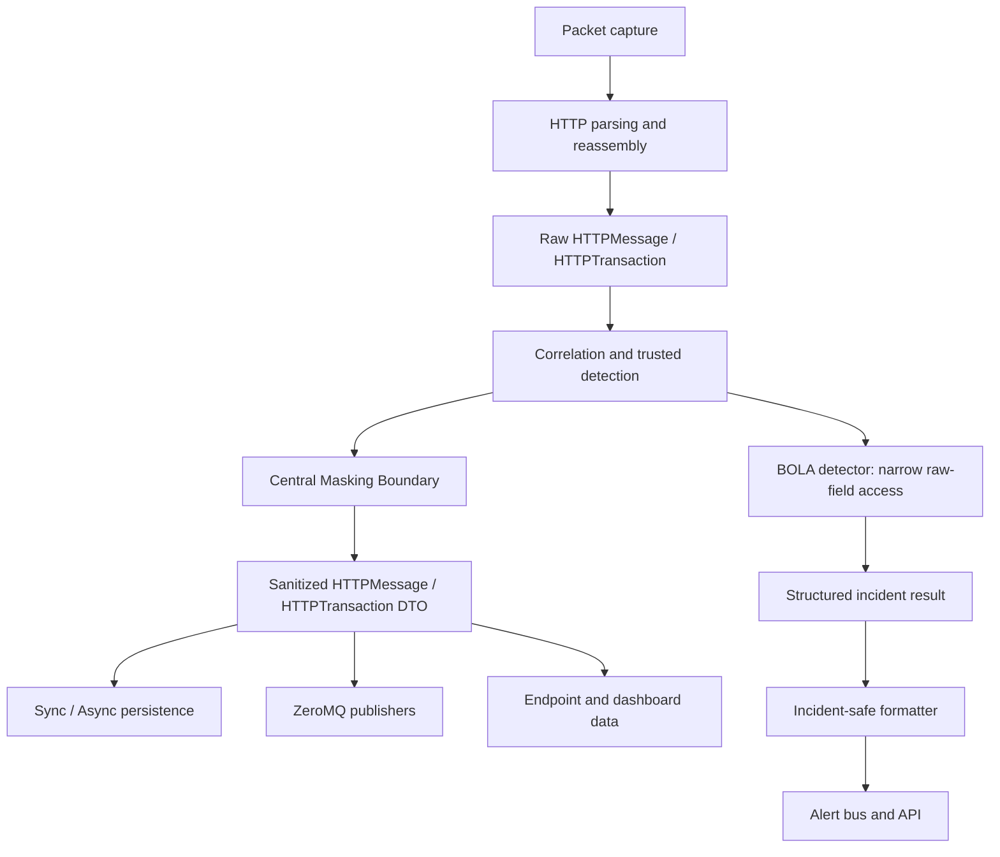

# Day 24 — Data Masking Architecture

**Date:** 2026-10-31
**Repository:** `API-Sentinel`
**Branch baseline:** `backend-parser`
**Baseline commit:** `27573a6a29f3ef41ba62f3d3ed9612c48b4bee63`
**Scope:** Architecture and design only. No runtime code changes are part of Day 24.

## 1. Objective

Define a masking architecture that prevents sensitive values in captured HTTP traffic from reaching persistent storage, ZeroMQ consumers, API/dashboard responses, alert streams, or other downstream outputs.

The design must preserve the raw values needed by trusted detection logic. In particular, the current lab-scoped BOLA detector inspects selected request and response values to associate a bearer-token fingerprint with a user and compare that user with an invoice owner. Masking must not silently break that detection path.

The core rule is:

> Raw captured traffic is restricted input for trusted in-process parsing and detection. Every persistence or outbound boundary receives a separately created, sanitized representation.

This is an architecture decision, not a claim that the current application already meets the rule.

## 2. Findings from the current implementation

The following findings were confirmed by the Day 24 source inspection.

| Area | Current behavior | Exposure / design implication |
|---|---|---|
| `app/security_detection.py` | `redact_headers()` masks selected header names. `redact_body()` parses JSON and recursively masks values under selected sensitive keys. Non-JSON bodies are returned unchanged. | Coverage is incomplete. Form data, XML, plain text, multipart, binary and unknown formats are not safely handled. |
| `app/transaction_store.py` | Request and response headers/bodies are redacted before `TransactionLog` persistence. `request_uri` is stored from `request.uri` unchanged. | Query strings and identifier-bearing path segments can be persisted. |
| `app/async_transaction_store.py` | The asynchronous store applies the same header/body helpers and also stores `request.uri` unchanged. | The sync and async paths must share one canonical masking policy. |
| `app/http_pipeline.py` | Completed raw transactions are appended to `completed_transactions`, enqueued for persistence, and published through `publish_transaction()`. Each parsed message is also published through `publish()`. | Raw traffic leaves the pipeline through ZeroMQ. Redacting only at the database layer is insufficient. |
| `app/message_broker.py` | Message serialization includes headers and a Base64 representation of the message body. Transaction serialization uses those message representations. | Base64 is reversible encoding, not masking. Serialize sanitized data, not raw data. |
| `app/persistence_worker.py` | `PersistenceJob` holds the original `HTTPTransaction` in a bounded queue. | The queue is a restricted transient raw-data location. It must not be treated as sanitized merely because the worker eventually redacts database columns. |
| `app/security_detection.py` — BOLA | The detector reads the raw Authorization header and selected login/invoice response values. It stores a SHA-256 token fingerprint in its in-memory identity map, not the raw bearer token. | Keep raw access narrowly scoped to the detector. Do not mutate the original transaction before BOLA inspection. |
| BOLA incident creation | The incident description includes `requester_id`, `invoice_id`, `owner_id`, and the observed path. | Free-text alert descriptions can disclose identifiers even when transaction bodies are masked. |
| `app/schemas.py` / `app/alert_bus.py` | The incident schema and `AlertEvent` include `description` and `source_ip`. The schema returns the description directly. | Alert/API fields require their own safe-output policy; structured event schemas are not automatically sanitized. |
| Endpoint storage | The synchronous `_upsert_endpoint()` stores a path returned by `_endpoint_identity()`. | Ensure endpoint identity is a route template or otherwise sanitized, not a raw user-specific path. The exact `_endpoint_identity()` implementation must be checked during Day 25 implementation before changing it. |

The Day 24 grep did not establish a transaction-body API response route. The known `/api/v1/alerts` output does expose incident descriptions and source IPs; `/api/v1/metrics` is aggregate. Day 25 should re-check API serializers and alert publication paths when implementation changes are made.

## 3. Security objectives and data-flow boundaries

### 3.1 Security objectives

1. No raw HTTP body, raw secret-bearing header, or raw sensitive URI is written to a database.
2. No raw HTTP message or transaction is published to an external/inter-process ZeroMQ topic.
3. No alert description or API response reintroduces sensitive values from raw traffic.
4. The BOLA detector can inspect only the raw fields it needs, inside the trusted processing path.
5. The original `HTTPMessage` and `HTTPTransaction` objects are not modified in place by sanitization.
6. Unknown or unsupported payload formats fail closed at outbound boundaries.
7. Sanitization is deterministic, testable, observable, and consistent across sync and async persistence.
8. Useful security telemetry remains available without retaining unnecessary personal data.

### 3.2 Trust zones

**Restricted raw-data zone**
- Packet parsing and HTTP reassembly.
- Transaction correlation.
- The narrowly scoped BOLA inspection step.
- Short-lived raw references required to complete the above operations.

**Sanitized-data zone**
- Database transaction records.
- Endpoint discovery records and API/dashboard data.
- ZeroMQ message and transaction topics.
- Alert bus / API alert payloads.
- Reports, exports, logs, and future integrations.

A loopback ZeroMQ endpoint is still an inter-process boundary. Binding to `127.0.0.1` does not make raw payload publication an acceptable data-handling policy.

## 4. Target architecture



The diagram describes the target design. It is not the current runtime flow.

### 4.1 Canonical masking boundary

Introduce a centralized masking module/service (proposed name: `app/data_masking.py`) with pure functions that accept raw values and return new sanitized values.

Proposed public contract:

```python
sanitize_headers(headers, policy=DEFAULT_POLICY) -> dict
sanitize_uri(uri, policy=DEFAULT_POLICY) -> str
sanitize_body(body, content_type=None, policy=DEFAULT_POLICY) -> SanitizedBody
sanitize_message(message, policy=DEFAULT_POLICY) -> SanitizedHTTPMessage
sanitize_transaction(transaction, policy=DEFAULT_POLICY) -> SanitizedHTTPTransaction
sanitize_incident(incident_or_payload, policy=DEFAULT_POLICY) -> SanitizedIncident
```

The exact class names and types can be adapted to the repository's existing dataclasses and models. The important contract is that the output is a distinct sanitized DTO or deep copy; it must not be the original mutable object.

`SanitizedBody` should carry:
- sanitized body bytes or text;
- an outcome such as `sanitized`, `omitted`, or `unsupported`;
- a safe reason/category for metrics (not the original value);
- optionally the detected media type.

It must not carry a copy of the rejected raw payload in an error field or debug message.

### 4.2 Pipeline ordering

1. Capture, parse, reassemble and correlate the original traffic.
2. Run trusted detectors that require raw fields, including the current BOLA heuristic.
3. Build safe structured incident fields. Do not format raw IDs or request data into free-text descriptions.
4. Sanitize a separate copy of each message/transaction.
5. Send only sanitized objects to persistence, ZeroMQ, alert/API output, endpoint indexing, and any future export.
6. Release references to raw transactions as soon as the trusted processing step no longer needs them.

If the existing architecture requires publishing individual messages before a transaction is complete, that message path must invoke `sanitize_message()` before serialization. It cannot wait for transaction completion.

For completed transactions, the preferred design is to sanitize once after correlation and pass the resulting DTO to both sync/async persistence and transaction publishers. Avoid independently implementing slightly different redaction rules in each consumer.

### 4.3 Raw object ownership and lifetime

The raw transaction is needed for correlation and BOLA inspection. The masking layer must not overwrite `request.headers`, `response.headers`, `request.body`, `response.body`, or `request.uri` on the original object.

The current `completed_transactions` deque and persistence queue can retain raw transactions. Day 25 must make an explicit ownership decision:
- Prefer storing sanitized DTOs in any history/cache intended for dashboard or diagnostic access.
- Keep raw transaction references only in the minimum queue or call scope required for trusted detection and ordered persistence.
- If a raw queue is still required, document its access restrictions, maximum retention, and cleanup behavior. Do not expose it through generic inspection endpoints or debug dumps.
- Avoid logging `repr(transaction)`, headers, body fragments, bearer tokens, cookies, or raw URI values.

## 5. Data classification and masking policy

The table below is the proposed baseline. A production deployment should make data retention and jurisdiction-specific classifications explicit rather than assuming all identifiers have the same legal status.

| Data element | Default treatment | Notes |
|---|---|---|
| `Authorization`, `Proxy-Authorization` | Replace value with `[REDACTED]` | Never publish or persist raw bearer/basic credentials. BOLA may read the raw value only inside its trusted detector. |
| `Cookie`, `Set-Cookie` | Replace value with `[REDACTED]` | Includes session identifiers and tracking cookies. |
| API keys, access/refresh tokens, client secrets, passwords, private keys | Replace with `[REDACTED]` | Match common key aliases and secret-like values, not only a short exact-name list. |
| Query parameters | Remove or redact sensitive parameter values | Preserve safe parameter names where useful. Do not retain arbitrary query strings by default. |
| URI path identifiers | Replace identifier-like segments with stable placeholders such as `:id` | Preserve route shape for endpoint discovery. Do not blindly redact static route words. |
| URI fragment / user-info | Drop or redact | Fragments and user-info are not needed for server-side route telemetry. |
| JSON fields with sensitive names | Recursively redact | Existing behavior can be retained as one layer, with expanded key normalization and value-pattern checks. |
| URL-encoded forms | Parse and redact fields, then re-encode safely | Do not pass through raw form values when parsing fails. |
| XML | Parse with a hardened, non-network parser and redact configured sensitive elements/attributes | Disable external entities/DTD processing. If safe parsing is not possible, omit the body. |
| Multipart forms | Parse metadata and parts under size/count limits; redact field values and filenames as policy requires | Do not publish raw multipart boundaries/parts when parsing fails. |
| Plain text | Apply bounded pattern-based detection for known secret/identifier formats | Heuristics cannot reliably identify every name/address. Unknown content should not pass through unchanged. |
| Binary, compressed, unknown, malformed or oversized body | Omit body or replace with a safe marker | Preserve content length, media type and an outcome flag where useful; never fall back to raw bytes. |
| Incident description | Generate from approved structured fields and templates | Do not embed raw user IDs, invoice IDs, raw paths, request snippets, or token values. |
| Source/destination IP | Apply an explicit deployment policy | IP addresses may be necessary for security investigation but can be personal data. Support allow/retain, truncate/pseudonymize, or omit according to policy. |
| Host, method, status, timestamps, duration, byte counts | Retain by default | Validate host/header handling and avoid embedding credentials in authority/user-info. |
| Connection/transaction IDs | Retain if generated internally and non-sensitive | Do not use raw credential or personal identifier values as IDs. |

### 5.1 Important distinction: key matching versus value detection

A sensitive JSON key such as `access_token` is easy to detect. A secret embedded in an innocent-looking field such as `message`, `debug`, or `value` is harder.

Use layered protection:
1. Normalize and match sensitive field names.
2. Apply bounded value-pattern detection for well-known formats (for example, bearer credentials, common API-key patterns, email addresses, phone-like values, and card-like digit sequences).
3. Use format-specific parsers where safe.
4. Omit unsupported content rather than passing it through.

Pattern matching is not proof that all PII has been found. Document false positives and false negatives. Avoid claiming complete PII removal.

### 5.2 URI policy

`request_uri` must not be persisted unchanged.

The sanitizer should:
- parse the URI without logging it;
- strip user-info and fragments;
- remove or redact query values by default;
- preserve safe query parameter names only when useful;
- replace dynamic identifier-like path segments with placeholders;
- handle absolute-form and origin-form request targets;
- handle malformed URIs by returning a safe placeholder or omitting the URI, never by returning the original malformed string.

Run BOLA route checks and any raw-path-dependent detection before URI sanitization. Endpoint discovery must use a safe route identity, not a per-user resource identifier.

## 6. Persistence and messaging rules

### 6.1 Database

Both `TransactionStore` and `AsyncTransactionStore` must consume the same sanitized transaction representation or call the same canonical sanitizer before mapping to ORM fields.

Required fields to sanitize:
- `request_uri`;
- request and response headers;
- request and response bodies;
- any future free-text or metadata field sourced from captured traffic.

Batch and single-save paths must use identical policy and output. The existing difference between batch and single-save code paths must not create different privacy behavior.

### 6.2 ZeroMQ

All public publisher methods must accept sanitized message/transaction DTOs or sanitize internally at a single enforced boundary.

Before Base64 encoding:
1. sanitize the body bytes;
2. encode the sanitized bytes;
3. serialize only sanitized headers and URI.

Never Base64-encode raw content and label the result safe.

The legacy `b"http.transaction"` topic and the discovery/heuristics transaction topics must be included in the same rule. No alternate raw compatibility topic should remain enabled by default.

### 6.3 Alerts and API

BOLA detection should return structured evidence with the minimum necessary fields. The outward alert description should be a generic statement, for example:

`Potential BOLA behavior: a request associated with one observed identity accessed an invoice associated with a different owner.`

Do not include:
- raw user IDs;
- invoice IDs;
- bearer token or token fingerprint;
- raw request URI;
- body excerpts.

Where investigation requires correlation, use the internal transaction/incident IDs and access-controlled drill-down to sanitized transaction data. If exact owner/requester identifiers are operationally required, create explicit structured fields and apply access controls and retention policy; do not bury them in free text.

Review all alert producers and API schema outputs, not only the BOLA path. A Pydantic schema validates shape and type; it does not mask values.

## 7. Fail-closed behavior and operational observability

### 7.1 Fail-closed policy

At persistence and outbound boundaries:
- If body format is supported and parsing/sanitization succeeds, emit the sanitized body.
- If parsing fails, the content is malformed, exceeds configured limits, or uses an unsupported format, omit the body or emit a fixed safe marker.
- Never use `except Exception: return original_body`.
- Never log the raw body as part of a sanitizer exception.
- A sanitizer failure must not cause an unmasked publish or database write.

The initial policy should favor confidentiality over retaining opaque body content. The cost is reduced forensic visibility for unsupported payloads. That trade-off is deliberate and must be visible in telemetry.

### 7.2 Safe metrics

Add counters, not payload samples:
- `masking_body_sanitized_total`
- `masking_body_omitted_total`
- `masking_body_unsupported_total`
- `masking_parse_failure_total`
- `masking_sensitive_value_replaced_total`
- `masking_uri_sanitized_total`
- `masking_incident_description_sanitized_total`
- `masking_failure_total`

Metrics may be labeled by bounded categories such as `content_type_family` and `outcome`. Do not label by raw path, host, field value, IP, token, or user ID. Avoid high-cardinality labels.

A masking failure should be visible and should block the affected outbound/persistence payload, but should not dump the raw content into logs.

## 8. Day 25 implementation sequence

Day 25 should implement the architecture in small, testable changes. Suggested order:

1. **Inspect exact types and call graph.** Confirm `HTTPMessage`, `HTTPTransaction`, `_endpoint_identity()`, all publisher call sites, alert producers, and API serialization paths before changing interfaces.
2. **Define sanitizer DTOs and policy.** Centralize sensitive key normalization, safe placeholders, URI behavior, supported content types, size limits, and fail-closed outcomes.
3. **Implement header and URI sanitization.** Add tests for case, hyphen/underscore aliases, duplicate headers, query values, path IDs, malformed URIs, absolute/origin-form targets, and user-info.
4. **Implement body sanitization.** Start with JSON and URL-encoded content. Add bounded plain-text patterns. Add XML/multipart only with hardened parsing and size limits. Omit binary/unknown/malformed data.
5. **Preserve raw detector semantics.** Verify BOLA inspection still sees the original request/response values, while persisted and published DTOs contain no raw values.
6. **Integrate sync and async persistence.** Cover both batch and single-save code paths; ensure `request_uri` is sanitized.
7. **Integrate all ZeroMQ publishers.** Verify individual-message and completed-transaction topics emit sanitized content before Base64 encoding.
8. **Sanitize incidents and alert outputs.** Remove sensitive identifiers from generated free text and review all fields exposed by `/api/v1/alerts`.
9. **Review transient storage and logs.** Decide how to handle the raw `completed_transactions` deque and persistence queue; ensure debug logging never serializes raw transaction objects.
10. **Run regression and acceptance tests.** Run focused tests, full pytest suite, compile checks, `git diff --check`, and inspect serialized output from each outbound boundary.

Do not combine every format parser and every pipeline refactor into one large patch. First land the central contract and its tests, then integrate each output boundary.

## 9. Day 25 test requirements

### Sanitizer unit tests
- sensitive headers are redacted regardless of header-name case;
- aliases using hyphen, underscore, and whitespace normalize consistently;
- JSON nested dict/list values are redacted;
- URL-encoded secrets are redacted;
- recognized text patterns are masked without logging source values;
- malformed JSON, XML, form data, binary and unknown content fail closed;
- oversized bodies are omitted;
- query values and fragments do not leak;
- dynamic path identifiers are converted to placeholders;
- malformed URIs do not pass through unchanged;
- sanitization returns a new object and leaves the original object unchanged.

### Integration tests
- sync single-save and batch-save persist only sanitized values;
- async single-save and batch-save persist only sanitized values;
- every ZeroMQ message/transaction topic contains sanitized headers, URI and body;
- Base64-decoded published bodies contain no test secret;
- BOLA detector still detects the existing lab scenario using raw values;
- BOLA alert description contains no requester, owner, invoice, token, or raw path value;
- alert bus/API serialization contains no test secrets;
- sanitizer failure prevents raw persistence/publication;
- no raw transaction is exposed by dashboard/history endpoints.

### Regression checks
- existing transaction correlation and parsing behavior remains intact;
- existing BOLA detection semantics remain intact;
- queue backpressure and worker shutdown behavior remain intact;
- full test suite passes;
- no test relies only on checking the database while ignoring ZeroMQ and alerts.

Use synthetic secrets and synthetic PII-like values in tests. Never use real credentials or personal data as fixtures.

## 10. Acceptance criteria for the masking milestone

The milestone is not accepted merely because `redact_body()` has more patterns or because database rows look masked.

Acceptance requires evidence that:
1. Database rows contain sanitized URI, headers and bodies in every sync/async path.
2. No ZeroMQ topic publishes raw header/body/URI values.
3. Base64 payloads are checked after decoding, not just visually inspected as encoded strings.
4. BOLA can still operate on restricted raw input and the emitted alert is safe.
5. Alert/API outputs are reviewed for free-text leakage.
6. Unknown, malformed and oversized payloads fail closed.
7. Sanitization does not mutate source transactions.
8. Raw transient buffers and queue ownership/retention are documented and bounded.
9. Focused tests and the full regression suite pass.
10. Operational behavior is validated separately from automated unit-test success.

## 11. Explicit non-goals and open decisions

- Day 24 does not implement masking code.
- Day 24 does not claim full PII discovery; pattern-based detection is inherently incomplete.
- Day 24 does not decide the organization's legal basis, retention period, or jurisdiction-specific treatment of IP addresses and user identifiers.
- Day 24 does not make raw capture safe for arbitrary downstream consumers. Raw capture remains restricted.
- Exact treatment of IP addresses, hostnames, filenames, and route identifiers needs an explicit deployment policy.
- The exact endpoint identity helper and all alert producer call sites must be revalidated during Day 25 implementation.
- The BOLA rule remains a lab heuristic. Masking does not make its identity attribution cryptographically trustworthy.

## 12. Day 24 completion record

**Architecture outcome:** Defined a centralized masking boundary for persistence and all outbound paths, preserved a restricted raw-data lane for trusted detection, identified raw ZeroMQ publication, unmasked request URIs, transient raw buffers, and free-text incident descriptions as exposure paths, and specified fail-closed behavior plus Day 25 tests.

**Code changes:** None by design.

**Next task:** Day 25 — implement the central sanitizer and test it independently before integrating persistence, ZeroMQ, and alert/API boundaries.
